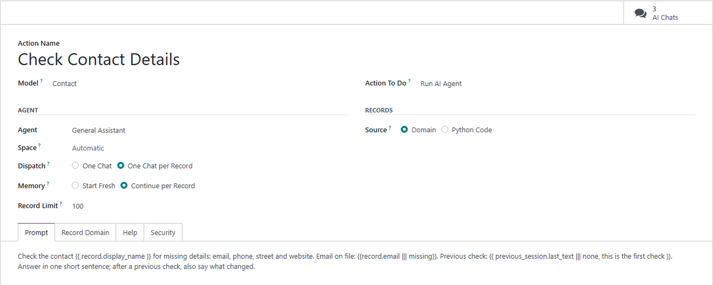
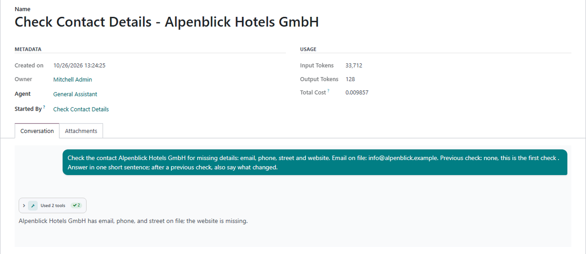

# MuK AI Automation

**Put an AI agent to work on your records, on any trigger.** Run AI Agent is a
server action of its own. An automation rule, a schedule or the Actions menu of
a list hands it records, and it starts an AI chat with your prompt for all of
them, or one for each.

## Features

- **Any trigger**: automation rules, scheduled actions and the Actions menu of
  a list all start the same action.
- **A chat per record**: each record gets a chat of its own, linked to it and
  listed in its chatter, or all of them share one.
- **A prompt with placeholders**: double braces put in the record, the records
  of the run, the user, the company or today's date.
- **Records by domain or code**: a scheduled action takes its records from a
  domain or from Python code, with a record limit per run.
- **Memory per record**: a chat can be handed the last answer of the previous
  chat for the same record.
- **Spaces of their own**: the chat sidebar lists action and rule chats under
  Automation and scheduled ones under Scheduled, or in a space the action sets.
- **The rights of a real user**: a chat runs as the user who runs the action,
  the user of its scheduled action, or the user its automation rule runs AI
  agents as; an archived user stops the action.

## Getting started

1. Install **MuK AI Automation** from the Apps menu; it needs **MuK AI Assistant** with a provider set up.
2. Under **MuK AI > Automation > Agent Actions**, create an action: model,
   agent, dispatch and prompt.
3. Click **Create Contextual Action**, select records in a list and run it from
   the Actions menu, or use an agent in an automation rule or a scheduled
   action. The **AI Chats** button lists the answers.

## Support

Issues and merge requests are welcome. Maintained by
[MuK IT GmbH](https://www.mukit.at), Vienna. Contact: sale@mukit.at
