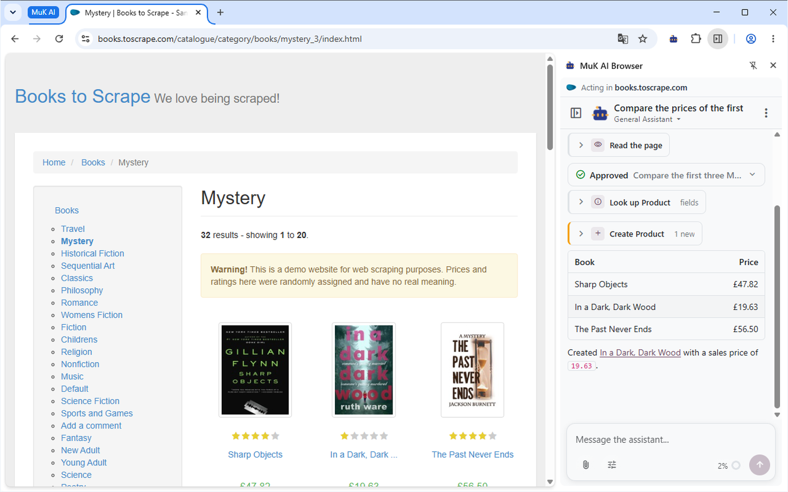
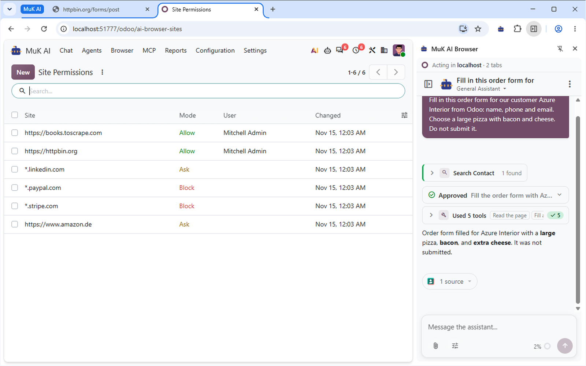

# MuK AI Browser

**Your Odoo assistant, in the browser next to it.** The MuK AI chat in
Chrome's side panel reads the pages you work on, clicks, types and fills forms,
and brings what it finds into Odoo. The agent, its rules, its approvals and
its log stay in your Odoo.

## Features

- **The chat in the side panel**: the same chat, agents and tools as inside
  Odoo, beside any web page.
- **Reads, clicks, types**: reads the page, clicks, types, fills whole forms,
  scrolls and takes screenshots, in a tab group named "MuK AI".
- **Odoo records in the group**: looks up and creates records, and opens the
  record it made in a tab next to the website.
- **A plan first**: a task of several steps starts with a plan you approve,
  naming the sites it needs.
- **Allow, ask or block per site**: rules for one user or for everyone; form
  submits and words like pay or delete always ask first.
- **Never the risky fields**: it never types into password, payment card or
  one-time code fields and never uploads a file.

## Getting started

1. Install **MuK AI Browser** from **Apps**; it needs **MuK AI** with a
   provider set up.
2. Install the
   [MuK AI Browser extension](https://chromewebstore.google.com/detail/fecogbhcchendbojonbojofkiehdacne)
   in Chrome 116 or newer, or in Edge, open its options, enter your Odoo
   address and click **Connect**.
3. Log in to Odoo in the tab that opens: it pairs the browser and closes
   itself.
4. Set what the assistant may do on a site without a rule under
   **MuK AI > Settings > Extensions > Browser**, and the site rules under
   **MuK AI > Configuration > Site Permissions**.
5. Open the side panel on any page, and ask.

## Support

Issues and merge requests are welcome. The extension is open source under
Apache-2.0: [muk-ai-browser-extension](https://github.com/muk-it/muk-ai-browser-extension).
Maintained by [MuK IT GmbH](https://www.mukit.at), Vienna. Contact:
sale@mukit.at
