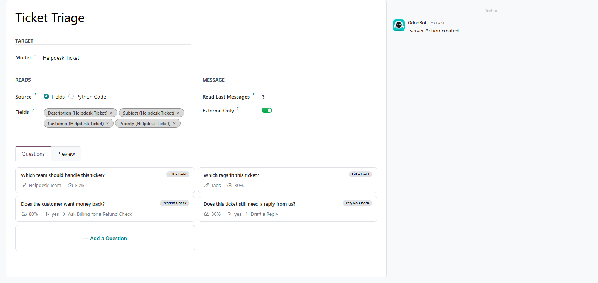
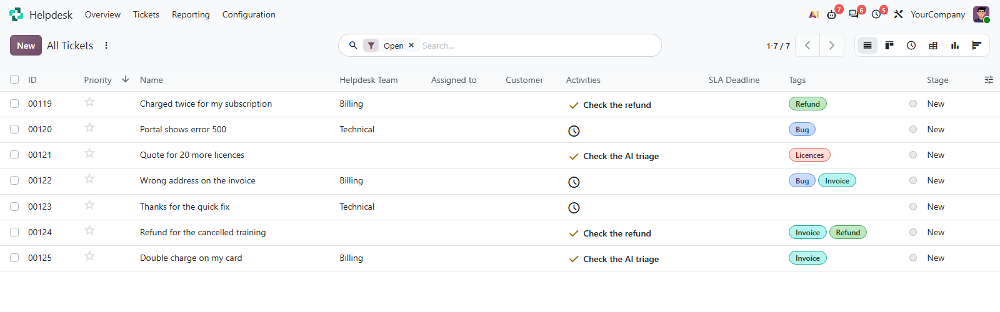

# MuK AI Decision

**Answer the questions you ask about every record, in about a second.** A
decision model reads a ticket, a lead or any text and answers fixed questions:
one choice out of a list, a score on a scale, or the chance of a yes, each with
its confidence. Use it to fill fields, route records and start an AI agent only
where one is needed.

## Features

- **Questions instead of prompts**: Decide with AI is a server action for any
  model; selection, many2one and tags fields bring their own options.
- **Written only when sure**: below its confidence an answer is never written,
  and the action for unsure decisions takes the record over.
- **Answers that route**: an answer runs another action on the records that
  gave it, or that the model was unsure about.
- **Agents only where needed**: a yes or no decision step in front of an agent
  starts its chats only for the records that need one.
- **The decide tool**: agents check texts, records or a whole domain in one
  call: spam or not, which tags, which team.
- **Hosted, local or what you have**: any System One server, TypeSafe Jev in the
  cloud or Laya behind Decis on your own hardware, or the small model of your
  chat provider; every decision is logged with its cost.

## Getting started

1. Under **MuK AI > Configuration > Providers**, give _TypeSafe_ its API key or
   _Decis_ the address of your server, or set a **Default Decision Model** on a
   chat provider.
2. Under **MuK AI > Automation > Decision Actions**, create an action for a
   model and add its questions.
3. Run it from the **Actions** menu of a list, an automation rule or a schedule,
   and read every answer under **MuK AI > Reports > Decision Logs**.

## Support

Issues and merge requests are welcome. Maintained by
[MuK IT GmbH](https://www.mukit.at), Vienna. Contact: sale@mukit.at
