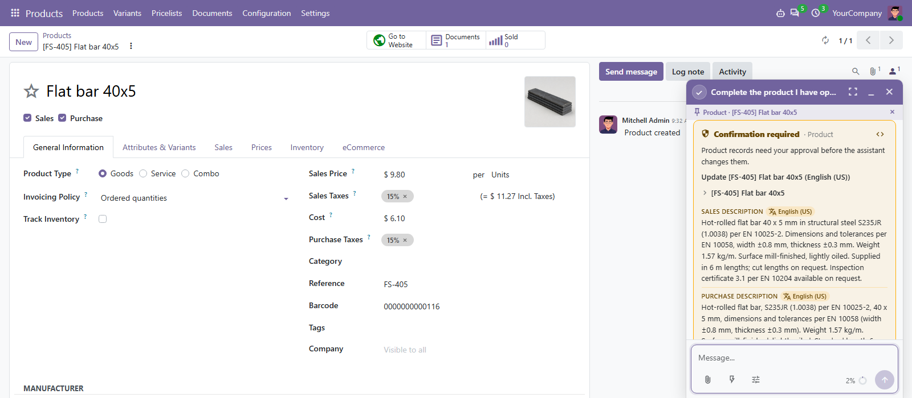

# MuK AI Product

**Products from a link or a price list, with texts from real facts in every
language you sell in.** A Product Content Writer adds products from a web shop
link or a vendor's price list, ready to purchase, looks each product up by its
manufacturer code, barcode or name, writes the name, the descriptions and the
shop texts from those facts only, translates them and adds image variants.
Every change waits for your approval.

## Features

- **Products from links and price lists**: a web shop or supplier page, or an
  Excel, CSV or PDF price list, becomes products with their vendor price, code
  and image; existing products get the new price instead of a duplicate. Long
  lists are read in the AI provider's code sandbox.
- **Facts from the web**: without a datasheet the writer searches for the
  product, prefers the manufacturer's page and datasheet, and names the source
  of every fact.
- **Texts from the facts**: name, sales and purchase description, and with
  eCommerce the shop description and the search texts.
- **One approval per language**: the base language first, and an HTML
  description keeps the same markup in every language.
- **Image variants**: a packshot, the product in use and a detail from the main
  photo, added as extra images marked as AI-generated.
- **Never generated**: barcodes, references, manufacturer data, energy labels
  and safety information stay as the manufacturer gives them.

## Getting started

1. Set up an AI provider with a chat model, and an image model for the image
   variants, in **MuK AI**.
2. Open a product, start a chat, switch to the **Product Content Writer** and
   pick **Complete this product**, or type `/` for a skill. To add products,
   send it a link or attach a price list and pick **Add products**.

## Support

Issues and merge requests are welcome. Maintained by
[MuK IT GmbH](https://www.mukit.at), Vienna. Contact: sale@mukit.at
