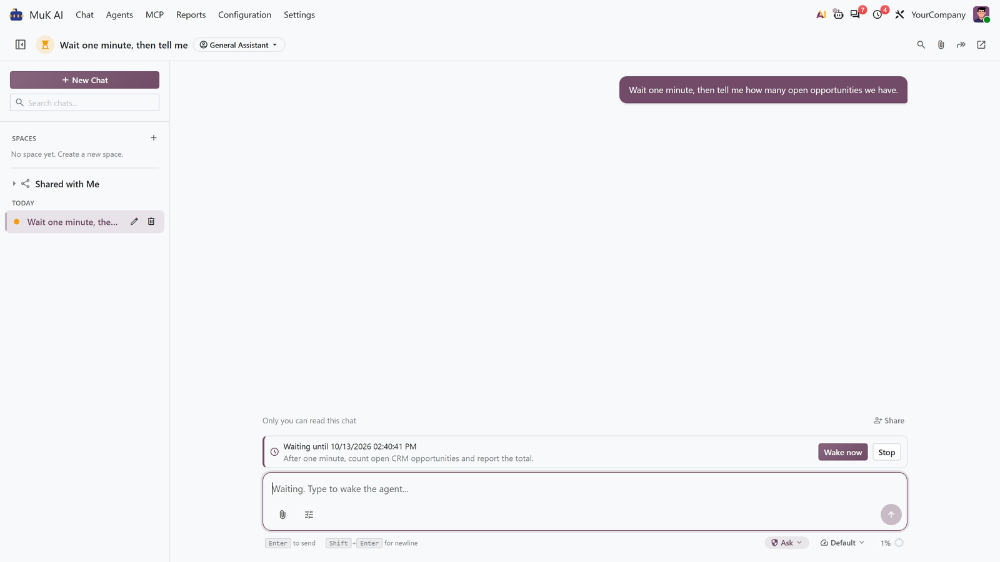

# MuK AI Schedule

**Let an agent wait, then carry on by itself.** An agent pauses its chat until
a time, until a record reaches a state or until somebody replies on a record,
and picks the task up again with the note it left itself, without anybody
watching.

## Features

- **Wait for a time**: "check again in an hour" or "send the reminder Monday at
  nine", up to thirty days ahead.
- **Wait for a record**: wake when an invoice is paid, a delivery is done or a
  lead is won. The condition is checked every minute without calling the model.
- **Wait for a reply**: wake when a message or an email is posted on the
  record, and read it in the result.
- **Always a way out**: every wait has a timeout, so a reply that never comes
  still wakes the agent to follow up.
- **You stay in control**: the chat shows what it waits for, with buttons to
  wake or stop it, and typing a message wakes it too.
- **Keep watch**: ask the agent to check every few minutes and report each
  time. It waits again after every check and stops when the outcome is there.
- **Bounded**: each chat may wait as often as the settings allow, and every
  wake-up runs within the usual turn limits.

## Getting started

1. Install **MuK AI Schedule** next to MuK AI.
2. Optionally set **Max waits per chat** in **MuK AI > Settings > Extensions**.
3. Ask an agent to follow something up, for example "remind Acme about the
   invoice and wait for their reply". It calls the wait tool and the chat shows
   what it waits for.

## Support

Issues and merge requests are welcome on the public repository. Paid work, such
as agents that follow up your own processes, goes to
[sale@mukit.at](mailto:sale@mukit.at). MuK IT GmbH, Vienna.
