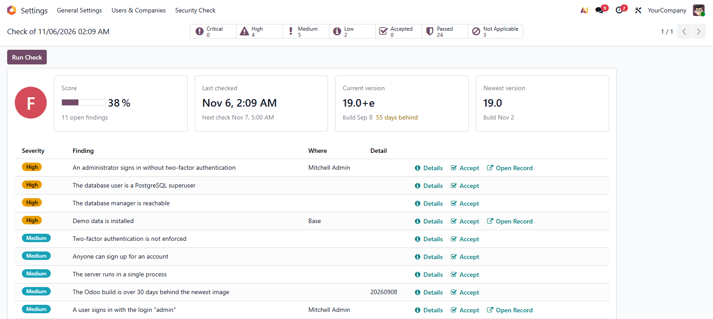
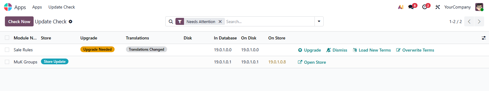
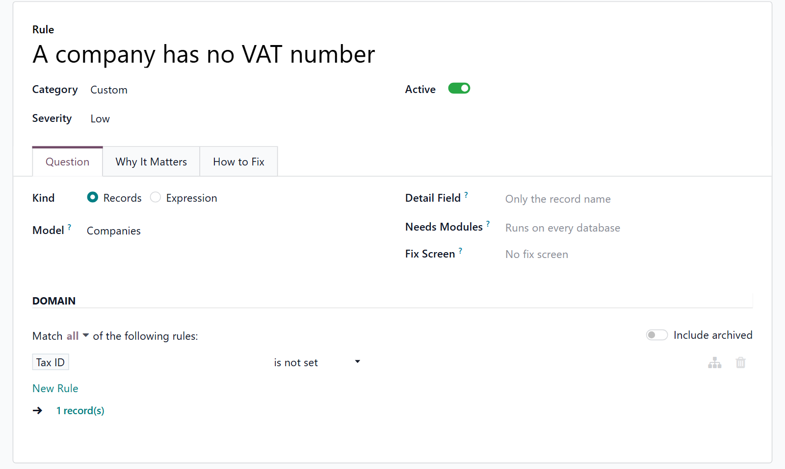

# MuK Check

**Know what needs attention in your database.** One score and one list cover unsafe
settings, exposed pages, an outdated Odoo, new store versions and real upgrade needs.
It reports what it finds and changes nothing on its own.

## Features

- **Server and sign-in**: the master password, the database manager, the database
  filter, proxy mode, two-factor sign-in, login cooldown and open sign-up.
- **Exposed pages and rights**: the public page that lists your apps and the exact
  Odoo version, once Website is installed, and records the public can change.
- **Background jobs**: scheduled actions that keep failing and a stopped cleanup job.
- **Odoo version**: an unsupported series, a newer series, and a build behind the
  newest official image.
- **App updates**: store versions and changelogs. An app that is not on the store
  simply shows no version.
- **Accepted risks**: accept a finding with a reason and an end date.
- **One channel message**: the Administrators channel hears about each new finding once.

- **Upgrades only when needed**: an app is flagged when its data, migrations, fields or
  constraints changed. JavaScript and Python methods do not count.
- **Translations on their own**: load new terms, or overwrite to apply changed wording
  that a normal upgrade leaves behind.
- **Rules in the browser**: turn a rule off, change its severity or write a new one with
  a domain or one Python expression. Other modules add rules with a small XML file.

## Getting started

1. Add the module to your addons path and install it from **Apps**.
2. No configuration is required. **Settings > General Settings > Security Check** turns off the
   online checks and the notifications.
3. Open **Settings > Security Check** and press **Run Check**, then see **Apps > Update Check**
   for your apps.

The online checks send the technical names of installed non-Odoo apps to apps.odoo.com
and read the official image tags from Docker Hub. Neither is a documented API, so a
check can stop working if the source changes.

## Support

Issues and merge requests are welcome. Maintained by
[MuK IT GmbH](https://www.mukit.at), Vienna. Contact: sale@mukit.at
