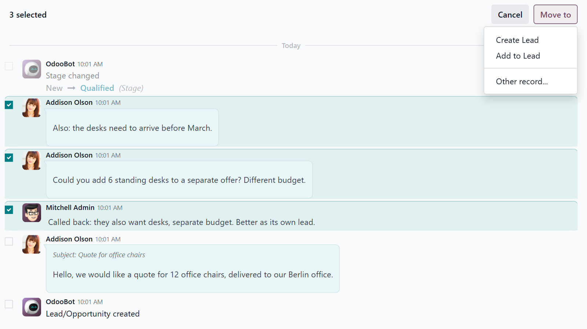

# MuK Mail Routing

This module collects mails that could not be routed and allows them to be
assigned subsequently. To simplify the workflow, predefined router settings
can be created. This allows lost messages, for example, to be created
directly as new CRM leads.

## Configuration

Go to **Discuss > Configuration > Routers** to create a new predefined routing option.

## Usage

There are now additional menus in the Discuss app to find the failed emails.
These can be manually added to the correct record using the action route.

In any chatter, choose **Move** in the actions of a message to pick emails and
notes and move them, files included, to another record or to a new one from a
router.

