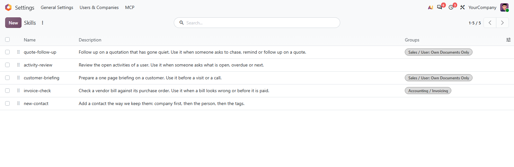
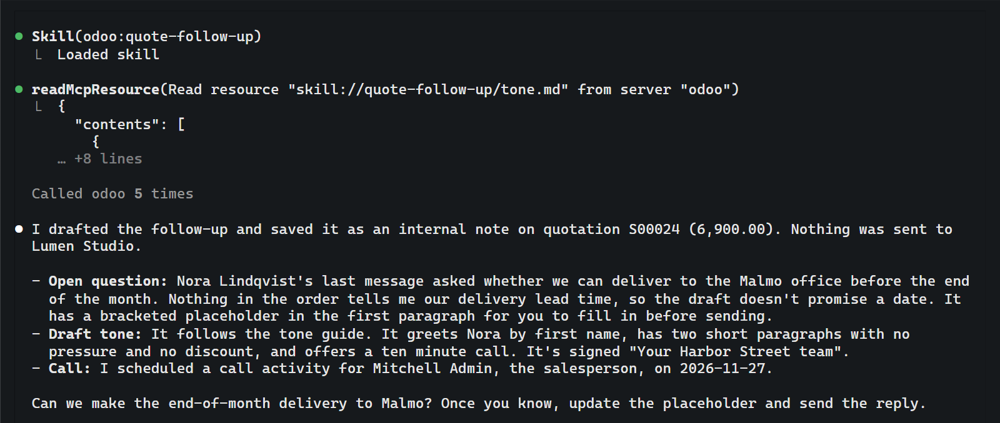

# MuK MCP Skills

**Teach Claude how your team works in Odoo.** Your AI client already reaches
Odoo over MCP. Now write down how things are done: a skill is a procedure with
its files, kept in Odoo and loaded by the client when a request fits.

## Features

- **Name and description**: the name is what a user can call it by, the
  description is what the client matches a request against.
- **Plain instructions**: markdown, the way you would explain it to a new
  colleague.
- **Files next to it**: a tone guide, a checklist or a template the client
  reads when the instructions send it there.
- **Groups decide who gets it**: a skill limited to a group is not listed, not
  found and not readable for anyone else.
- **Every version is verified**: each file is listed with its size and digest,
  so a client notices a change.

## Getting started

1. Install the module next to **MuK MCP Server**.
2. Open **Settings > MCP > Catalog > Skills** and write a skill: name,
   description, instructions, and files if it needs them.
3. Connect a client with **Settings > MCP > Connect**, then ask for what the
   skill describes or call it by its name, in Claude Code
   `/odoo:quote-follow-up`.

Skills need a client with the Skills extension of MCP and the protocol
revision `2026-07-28`.

## Support

Issues and merge requests are welcome. Maintained by
[MuK IT GmbH](https://www.mukit.at), Vienna. Contact: sale@mukit.at
